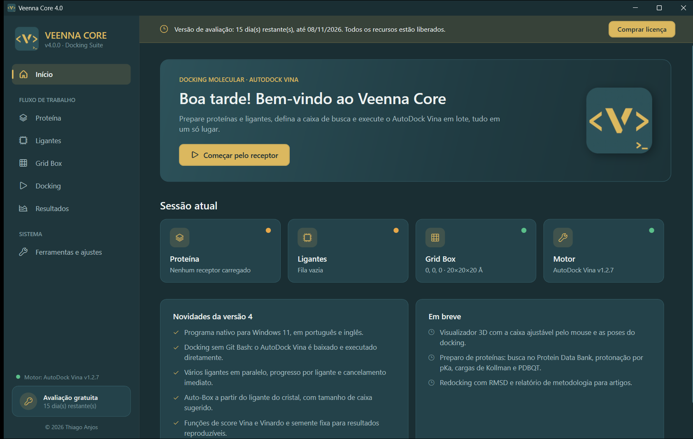

  

<h1 align="center">Veenna Core</h1>

  <b>Docking molecular com AutoDock Vina, simples e em lote</b> 
  <i>Molecular docking with AutoDock Vina, simple and in batch</i>

  
  
  

  <a href="https://github.com/thgdsrbrANJOS/veenna-core-releases/releases/latest"><b>⬇️ Baixar a versão mais recente / Download the latest version</b></a>
  &nbsp;·&nbsp;
  <a href="https://thgdsrbranjos.github.io/veenna-core-releases/"><b>🌐 Página do programa / Website</b></a>

  

---

## 🇧🇷 Português

O **Veenna Core** prepara e executa docking molecular com o **AutoDock Vina** em lote, sem linha de comando. Você carrega o receptor, monta a fila de ligantes, define a caixa de busca e acompanha cada ligante em tempo real.

### Destaques
- ⚙️ **AutoDock Vina automático:** o programa baixa o Vina e o executa diretamente, sem Git Bash nem terminal.
- 🧪 **Vários ligantes em paralelo**, com progresso por ligante, terminal ao vivo e cancelamento imediato.
- 🎯 **Auto-Box:** centro e tamanho da caixa a partir do ligante co-cristalizado do PDB.
- ⚗️ **Otimização com MOPAC** e conversões com **OpenBabel**, instalados pelo próprio programa.
- 📊 **Resultados:** tabela de afinidades, gráfico comparativo, CSV para Excel, poses separadas em MOL2 e abertura no Discovery Studio.
- 🌐 **Português e inglês**, no instalador e no programa.
- 🔄 **Atualizações automáticas**, assinadas digitalmente e conferidas antes de instalar.

### Instalação
1. Baixe o `VeennaCore_Setup_vX.Y.Z.exe` na [página de versões](https://github.com/thgdsrbrANJOS/veenna-core-releases/releases/latest).
2. Execute o instalador e escolha o idioma.
3. Use gratuitamente por **15 dias**, com todos os recursos. Depois disso, adquira uma licença.

### Licença
Para comprar, abra a tela **Licença** dentro do programa: lá estão os canais de contato e o seu ID de hardware, que deve ser enviado na compra.

Você recebe um arquivo `.lic`; basta arrastá-lo para a tela de ativação.

---

## 🇺🇸 English

**Veenna Core** prepares and runs **AutoDock Vina** molecular docking in batch, with no command line. Load the receptor, queue the ligands, set the search box and follow every ligand in real time.

### Highlights
- ⚙️ **Automatic AutoDock Vina:** the program downloads Vina and runs it directly, no Git Bash or terminal.
- 🧪 **Several ligands in parallel**, with per-ligand progress, a live terminal and instant cancel.
- 🎯 **Auto-Box:** box center and size from the PDB co-crystallized ligand.
- ⚗️ **MOPAC optimization** and **OpenBabel** conversions, installed by the program itself.
- 📊 **Results:** affinity table, comparison chart, CSV for Excel, poses split into MOL2 and Discovery Studio integration.
- 🌐 **Portuguese and English**, in the installer and the program.
- 🔄 **Automatic updates**, digitally signed and verified before installing.

### Installation
1. Download `VeennaCore_Setup_vX.Y.Z.exe` from the [releases page](https://github.com/thgdsrbrANJOS/veenna-core-releases/releases/latest).
2. Run the installer and choose the language.
3. Use it for free for **15 days**, with every feature. After that, purchase a license.

### License
To buy one, open the **License** screen inside the program: it shows the contact channels and your hardware ID, which you send when buying.

You will receive a `.lic` file; just drop it on the activation screen.

---

© 2026 Thiago Anjos. Software proprietário · Proprietary software. AutoDock Vina (Apache 2.0), OpenBabel (GPL) e MOPAC (LGPL) pertencem aos seus autores.

