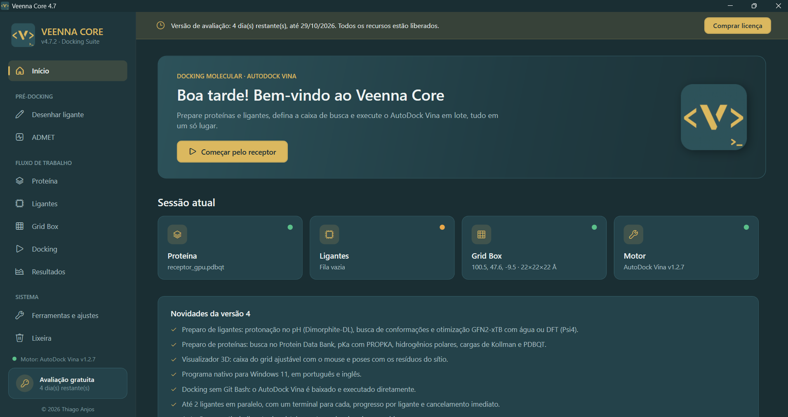

  

<h1 align="center">Veenna Core</h1>

  <b>Docking molecular com AutoDock Vina, simples e em lote</b> 
  <i>Molecular docking with AutoDock Vina, simple and in batch</i>

  
  
  

  <a href="https://github.com/thgdsrbrANJOS/veenna-core-releases/releases/latest"><b>⬇️ Baixar a versão mais recente / Download the latest version</b></a>
  &nbsp;·&nbsp;
  <a href="https://thgdsrbranjos.github.io/veenna-core-releases/"><b>🌐 Página do programa / Website</b></a>

  

---

## 🇧🇷 Português

O **Veenna Core** prepara e executa docking molecular com o **AutoDock Vina** em lote, sem linha de comando. Você carrega o receptor, monta a fila de ligantes, define a caixa de busca e acompanha cada ligante em tempo real.

### Destaques
- ⚙️ **AutoDock Vina automático:** o programa baixa o Vina e o executa diretamente, sem Git Bash nem terminal.
- 🧪 **Até 2 ligantes em paralelo**, com progresso por ligante, um terminal para cada e cancelamento imediato.
- 🎯 **Auto-Box:** centro e tamanho da caixa a partir do ligante co-cristalizado do PDB.
- ⚗️ **Preparo de ligantes:** protonação no pH (Dimorphite-DL), conformações (RDKit) e otimização GFN2-xTB com água ou DFT (Psi4), além de MOPAC e OpenBabel, instalados pelo próprio programa.
- 💊 **ADMET** no pré-docking, com desenho de ligantes no Ketcher.
- 📊 **Resultados:** tabela de afinidades, gráfico comparativo, CSV para Excel, poses separadas em MOL2 e abertura no Discovery Studio.
- 🌐 **Português e inglês**, no instalador e no programa.
- 🔄 **Atualizações automáticas**, assinadas digitalmente e conferidas antes de instalar.

### Instalação
1. Baixe o `VeennaCore_Setup_vX.Y.Z.exe` na [página de versões](https://github.com/thgdsrbrANJOS/veenna-core-releases/releases/latest).
2. Execute o instalador e escolha o idioma.
3. Use gratuitamente por **5 dias**, com todos os recursos. Depois disso, adquira uma licença.

### Licença
Para comprar, abra a tela **Licença** dentro do programa: lá estão os canais de contato e o seu ID de hardware, que deve ser enviado na compra.

Você recebe um arquivo `.lic`; basta arrastá-lo para a tela de ativação.

### Licenças e termos de uso
O Veenna Core é software proprietário (© 2026 Thiago Anjos), com avaliação gratuita de 5 dias a partir do primeiro uso. Os termos completos aparecem no instalador e devem ser aceitos antes da instalação. Em resumo: licença de uso pessoal e intransferível, vinculada ao computador; resultados de docking, protonação, otimização e ADMET são estimativas computacionais para pesquisa, sem garantia e sem uso clínico; o programa não envia suas moléculas nem dados pessoais.

Componentes de terceiros (cada um sob a própria licença, todas de código aberto e com uso comercial permitido; texto completo em **Ferramentas e ajustes → Licenças de terceiros**):
- **Incluídos:** Ketcher (Apache 2.0), OpenChemLib JS (BSD 3-Clause), 3Dmol.js (BSD 3-Clause), .NET (MIT), WebView2 SDK (Microsoft), QRCoder (MIT).
- **Baixados das fontes oficiais quando você pede:** AutoDock Vina e MOPAC (Apache 2.0), Open Babel (GPL 2.0, executado sem modificações), PROPKA (LGPL 2.1), OpenMM/PDBFixer (MIT), ADMET-AI (MIT) com Chemprop, RDKit e PyTorch, e o ambiente de química do conda-forge pelo micromamba (BSD): RDKit (BSD), xtb/GFN2-xTB (LGPL 3.0), Dimorphite-DL (Apache 2.0) e, opcional, Psi4 e simple-dftd3 (LGPL 3.0).
- **Dados:** RCSB PDB (CC0), AlphaFold DB (CC BY 4.0), percentil DrugBank do ADMET-AI (CC BY-NC 4.0, livre para uso acadêmico).

---

## 🇺🇸 English

**Veenna Core** prepares and runs **AutoDock Vina** molecular docking in batch, with no command line. Load the receptor, queue the ligands, set the search box and follow every ligand in real time.

### Highlights
- ⚙️ **Automatic AutoDock Vina:** the program downloads Vina and runs it directly, no Git Bash or terminal.
- 🧪 **Up to 2 ligands in parallel**, with per-ligand progress, one terminal each and instant cancel.
- 🎯 **Auto-Box:** box center and size from the PDB co-crystallized ligand.
- ⚗️ **Ligand preparation:** pH protonation (Dimorphite-DL), conformers (RDKit) and GFN2-xTB optimization in water or DFT (Psi4), plus MOPAC and OpenBabel, installed by the program itself.
- 💊 **ADMET** in pre-docking, with ligand drawing in Ketcher.
- 📊 **Results:** affinity table, comparison chart, CSV for Excel, poses split into MOL2 and Discovery Studio integration.
- 🌐 **Portuguese and English**, in the installer and the program.
- 🔄 **Automatic updates**, digitally signed and verified before installing.

### Installation
1. Download `VeennaCore_Setup_vX.Y.Z.exe` from the [releases page](https://github.com/thgdsrbrANJOS/veenna-core-releases/releases/latest).
2. Run the installer and choose the language.
3. Use it for free for **5 days**, with every feature. After that, purchase a license.

### License
To buy one, open the **License** screen inside the program: it shows the contact channels and your hardware ID, which you send when buying.

You will receive a `.lic` file; just drop it on the activation screen.

### Licenses and terms of use
Veenna Core is proprietary software (© 2026 Thiago Anjos), with a 5-day free evaluation from the first use. The full terms are shown in the installer and must be accepted before installing. In short: personal, non-transferable license bound to the computer; docking, protonation, optimization and ADMET results are computational estimates for research, with no warranty and no clinical use; the program does not send your molecules or personal data.

Third-party components (each under its own license, all open source and allowing commercial use; full text in **Tools and settings → Third-party licenses**):
- **Included:** Ketcher (Apache 2.0), OpenChemLib JS (BSD 3-Clause), 3Dmol.js (BSD 3-Clause), .NET (MIT), WebView2 SDK (Microsoft), QRCoder (MIT).
- **Downloaded from the official sources when you ask:** AutoDock Vina and MOPAC (Apache 2.0), Open Babel (GPL 2.0, run unmodified), PROPKA (LGPL 2.1), OpenMM/PDBFixer (MIT), ADMET-AI (MIT) with Chemprop, RDKit and PyTorch, and the conda-forge chemistry environment via micromamba (BSD): RDKit (BSD), xtb/GFN2-xTB (LGPL 3.0), Dimorphite-DL (Apache 2.0) and, optionally, Psi4 and simple-dftd3 (LGPL 3.0).
- **Data:** RCSB PDB (CC0), AlphaFold DB (CC BY 4.0), ADMET-AI DrugBank percentile (CC BY-NC 4.0, free for academic use).

---

© 2026 Thiago Anjos. Software proprietário · Proprietary software. Os componentes de terceiros pertencem aos seus autores e seguem as próprias licenças · Third-party components belong to their authors and follow their own licenses.

